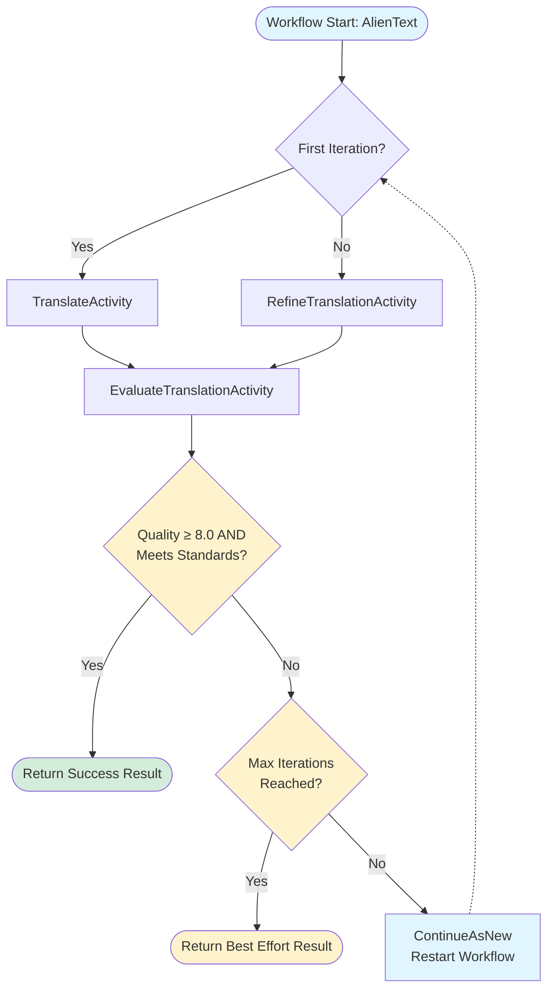

# Alien Translator - Evaluator-Optimizer Pattern

This demo implements an **evaluator-optimizer workflow** using Dapr Workflow for alien language translation refinement. The system generates an initial translation, then iteratively evaluates and refines it through multiple rounds until it meets quality standards.

## Pattern Overview

The evaluator-optimizer pattern separates translation generation from quality evaluation:

1. **Translator** (TranslateActivity/RefineTranslationActivity) - Generates and improves translations
2. **Evaluator** (EvaluateTranslationActivity) - Assesses quality and provides feedback
3. **Workflow** (EvaluatorOptimizerWorkflow) - Orchestrates the iterative refinement loop

### Benefits

- ✅ Iterative quality improvement with measurable metrics
- ✅ Specialized LLM roles (translator vs. evaluator)
- ✅ Detailed feedback loop for targeted refinements
- ✅ Graceful degradation with max iteration limit

### Drawbacks

- ❌ Higher latency (multiple LLM calls per translation)
- ❌ More expensive (10+ LLM calls for 5 iterations)
- ❌ Potential diminishing returns in later iterations
- ❌ Evaluation subjectivity (LLM can't verify true accuracy)

### When to Use

Use this pattern when quality is more important than speed and iterative refinement demonstrably improves results. Ideal for diplomatic communications, literary translation, and content requiring editorial review.

## Architecture



### Workflow Logic

1. Generate initial translation
2. Loop (max 5 iterations):
   - Evaluate current translation
   - If quality ≥ 8.0 and meets standards → Success!
   - If max iterations reached → Return best effort
   - Refine translation based on feedback
3. Return final translation with iteration history

### Quality Metrics

- **Accuracy Score** (0-10): Faithfulness to original meaning
- **Cultural Nuance Score** (0-10): Preservation of cultural context
- **Idiomatic Score** (0-10): Natural English readability
- **Overall Quality** (0-10): Holistic assessment

## Running the Demo

### Prerequisites

- [.NET 10 SDK](https://dotnet.microsoft.com/en-us/download)
- [Aspire CLI](https://aspire.dev/get-started/install-cli/) — install with `dotnet tool install -g Aspire.Cli`
- [Docker](https://www.docker.com/products/docker-desktop/) or [Podman](https://podman.io/docs/installation)
- [Dapr CLI](https://docs.dapr.io/getting-started/install-dapr-cli/) (version 1.18+)
- [Ollama](https://ollama.com/) with the `llama3.2:3b` model pulled

### Start Ollama

```bash
ollama serve
ollama pull llama3.2:3b
```

### Use OpenAI instead of Ollama

The `Resources` folder of the AppHost also contains `conversation-openai.yaml` (model `gpt-4.1-mini`) and `env-secret.yaml` (an environment variable secret store). Both Conversation components are named `conversation`, so keep only one of them in `Resources`. To use OpenAI, remove the Ollama component file and set the API key before starting the app:

```bash
export OPENAI_API_KEY=<your-key>
```

### Run the Application

From the `AlienTranslator/` folder:

```bash
aspire run
```

This launches the Aspire AppHost, which orchestrates:
- A Valkey container for workflow state persistence (port 16379, password-protected)
- The ApiService with a Dapr sidecar (app ID `alien-translator-app`)
- The `web` resource (LCARS web UI) on http://localhost:5501
- The Diagrid Dapr Dev Dashboard (`dapr-dev-dashboard` resource) on http://localhost:9090/workflows

The Aspire dashboard opens automatically in the browser at https://localhost:15000 (the same port for every demo), showing all resources and their status.

### Use the web UI

Open http://localhost:5501, pick a preset (Vulcan diplomatic, Klingon literary or Romulan casual) or edit the form, and choose **Translate**. The form takes the species (choose Other to type your own), the context, the original text, a list of known vocabulary (phrase and meaning rows; empty rows are ignored, a half-filled row or a duplicate phrase is an error) and optional cultural notes. The page polls the translate endpoint every 2 seconds. The running view is an iteration board: every finished iteration is a row with its quality bar (0 to 10, with a marker at the 8.0 threshold), the verdict `MEETS STANDARD` or `BELOW STANDARD` and an expandable translation, so you can watch the translation improve across the `ContinueAsNew` restarts. While the workflow runs, a `PROCESSING ITERATION n` row sweeps below the finished rows and a footer shows `ITERATION n / 5`. The result view shows the original text next to the final translation (with the translator's reasoning in an expandable), four score bars (accuracy, cultural nuance, idiomatic, overall), the strengths and weaknesses, the detailed feedback, the improvement summary and a small line chart of the overall quality per iteration (an iteration without a score has no dot and the line skips it). If the loop ended because it reached the maximum number of iterations, a `MANUAL REVIEW RECOMMENDED` note is shown.

**Durable timeline.** A strip of beads under the progress heading shows the saved steps of the run: one bead per finished iteration, with ghost beads up to the iteration limit (5 unless the status reports another). A bead flashes `saved` when it appears while you watch. The strip is driven by the status the workflow reports, not by a timer.

**Decoded translation preview and quality gauge.** When an iteration row appears while you watch, its translation text decodes character by character from scrambled glyphs (the final translation in the result view decodes the same way), the quality bar fills from 0 to the real score and the `MEETS STANDARD` / `BELOW STANDARD` verdict fades in after it. Rows that were already there when the page first rendered appear instantly.

**Show the crash.** Start a run, then stop only the ApiService resource `wf-app` while the run is going: use the Stop action for `wf-app` in the Aspire dashboard at https://localhost:15000, or run `aspire resource wf-app stop`. Within a few seconds (typically 5 to 7) the page shows `Subspace link lost: state is safe`, the current bead turns red, the beads freeze and a counter shows how long the link has been down. Start `wf-app` again (the dashboard, or `aspire resource wf-app start`). The page reports that the link is restored and how many checkpoints were saved, and the run continues with the saved steps kept. The step that was running at the moment of the crash is executed again. The animations respect the browser's reduced-motion setting and show the final state at once.

**Token usage.** Each activity that calls the LLM returns its result wrapped in `Metered<T>` together with the prompt and completion tokens the provider reported. The workflow adds these up and publishes the running total as `usage` (`promptTokens`, `completionTokens`, `totalTokens`) in its custom status, so the status endpoint returns it as `progress.usage`. The progress panel shows a running **Tokens** readout that counts up as polls arrive, and the findings panel shows the final total with the prompt/completion split. If the provider reports no usage (null or zero), the page shows `--`. Tokens of failed or retried attempts are not counted. The running total is carried across `ContinueAsNew` in an optional trailing `Usage` on the workflow input. Runs that were in flight before upgrading to this version fail on replay (the activity outputs changed to `Metered<T>`), so let them finish or reset the state store (stop the app and clear Valkey) first.

### Test with REST Client

Open `AlienTranslator.ApiService/AlienTranslator.ApiService.http` in VS Code and execute the requests to translate alien texts. The ApiService HTTP port is shown in the Aspire dashboard.

### Inspect the Workflow runs

Open the Diagrid Dapr Dev Dashboard at `http://localhost:9090/workflows` and inspect the workflow executions.

## Inspect runs with the Diagrid Dapr Dev Dashboard

The [Diagrid Dapr Dev Dashboard](https://github.com/diagridio/dev-dashboard) is an optional local tool that finds the apps you start with `dapr run` or Aspire and shows their workflow instances (status and execution history), sidecars, components, subscriptions and logs.

Install it once:

- macOS / Linux:

  ```shell
  curl -sSL https://raw.githubusercontent.com/diagridio/dev-dashboard/main/scripts/install.sh | sh
  ```

- Windows (PowerShell):

  ```powershell
  iwr -useb https://raw.githubusercontent.com/diagridio/dev-dashboard/main/scripts/install.ps1 | iex
  ```

`aspire run` starts it as the `dapr-dev-dashboard` resource; open it from the Aspire dashboard or at http://localhost:9090/workflows. If it is not installed, only that resource fails to start; the app keeps running.
