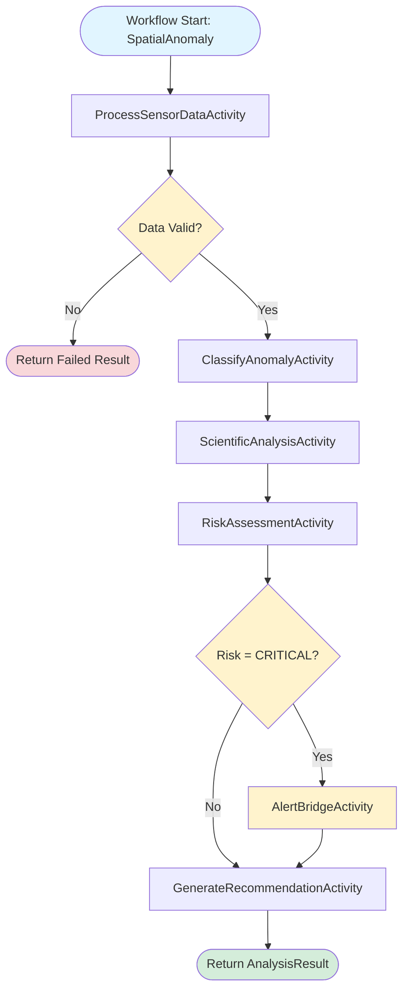

# Data's Spatial Anomaly Analysis System

This application implements Data's Spatial Anomaly Analysis System using Dapr Workflow to orchestrate a prompt chaining pattern. The system analyzes spatial anomalies detected by the USS Enterprise-D's sensors through a sequential 5-stage process.

## Pattern Overview

The **prompt chaining pattern** orchestrates multiple LLM calls in a sequential pipeline, where each stage's output becomes context for the next stage. This demo implements a 5-stage anomaly analysis workflow:

1. **Process Sensor Data** - Validates and normalizes raw sensor readings
2. **Classify Anomaly** - Categorizes the anomaly type and severity
3. **Scientific Analysis** - Deep dive into the physical phenomena
4. **Risk Assessment** - Evaluates potential threats to ship and crew
5. **Generate Recommendation** - Produces actionable response strategies
6. **Alert Bridge** (conditional) - Immediate notification for critical anomalies

### Benefits

- ✅ Sequential processing builds rich context across stages
- ✅ Specialized prompts optimized for each analysis phase
- ✅ Clear separation of concerns (validation → classification → analysis → recommendations)
- ✅ Easier debugging and monitoring per stage
- ✅ Workflow state management ensures reliability and observability

### Drawbacks

- ❌ Higher latency from sequential processing (no parallelization)
- ❌ Error in early stages blocks later stages
- ❌ Context window limitations with long chains
- ❌ More expensive than single LLM call

### When to Use

Use this pattern when analysis requires multiple specialized stages building on each other's output, and when the problem domain benefits from decomposition into distinct reasoning phases. Ideal for complex analysis, decision trees, and multi-step reasoning tasks.

## Architecture



- **Workflow**: `AnomalyAnalysisWorkflow` - Orchestrates 5 sequential stages
- **Activities**: Each stage is an LLM-powered activity using DaprConversationClient
  - ProcessSensorDataActivity
  - ClassifyAnomalyActivity
  - ScientificAnalysisActivity
  - RiskAssessmentActivity
  - GenerateRecommendationActivity
  - AlertBridgeActivity (triggered for critical anomalies)

## Running the Demo

### Prerequisites

- [.NET 10 SDK](https://dotnet.microsoft.com/en-us/download)
- [Aspire CLI](https://aspire.dev/get-started/install-cli/) — install with `dotnet tool install -g Aspire.Cli`
- [Docker](https://www.docker.com/products/docker-desktop/) or [Podman](https://podman.io/docs/installation)
- [Dapr CLI](https://docs.dapr.io/getting-started/install-dapr-cli/) (version 1.18+)
- [Ollama](https://ollama.com/) with the `llama3.2:3b` model pulled

### Start Ollama

```bash
ollama serve
ollama pull llama3.2:3b
```

### Use OpenAI instead of Ollama

The `Resources` folder of the AppHost also contains `conversation-openai.yaml` (model `gpt-4.1-mini`) and `env-secret.yaml` (an environment variable secret store). Both Conversation components are named `conversation`, so keep only one of them in `Resources`. To use OpenAI, remove the Ollama component file and set the API key before starting the app:

```bash
export OPENAI_API_KEY=<your-key>
```

### Run the Application

From the `AnomalyAnalysis/` folder:

```bash
aspire run
```

This launches the Aspire AppHost, which orchestrates:
- A Valkey container for workflow state persistence (port 16379, password-protected)
- The ApiService with a Dapr sidecar (app ID `anomaly-detection-app`)
- The `AnomalyAnalysis.Web` front-end (`web` resource) on http://localhost:5502, a Star Trek TNG (LCARS) styled page that forwards `/api/*` to the ApiService
- The Diagrid Dapr Dev Dashboard (`dapr-dev-dashboard` resource) on http://localhost:9090/workflows

The Aspire dashboard opens automatically in the browser at https://localhost:15000 (the same port for every demo), showing all resources and their status.

### Use the web UI

Open http://localhost:5502, pick a preset (Wormhole, Temporal rift or Quantum flux) or edit the sensor values, and choose **Begin analysis**. The page polls the status endpoint every 2 seconds, shows each of the five stages as it completes (expand a stage to read its output) and then shows the findings. A critical risk level switches the page to Red Alert.

The status endpoint (`GET /anomaly/status/{instanceId}`) returns `instanceId`, `status`, `result`, `progress` (the stages recorded so far, taken from the workflow custom status), `createdAt` and `lastUpdatedAt`.

**Durable timeline.** A strip of beads under the progress heading shows the saved steps of the run: one bead per finished stage, with ghost beads for the five stages. A bead flashes `saved` when it appears while you watch. The strip is driven by the status the workflow reports, not by a timer.

**Conduit packet.** Above the stage list a conduit shows the five stages (Sensor, Classify, Analyse, Risk, Recommend). A gold packet sits at the first stage that has not finished yet and glides to the next node when a stage completes, and the first characters of each stage output decode next to its node. Stages that were already finished when the page first rendered appear instantly.

**Show the crash.** Start a run, then stop only the ApiService resource `wf-app` while the run is going: use the Stop action for `wf-app` in the Aspire dashboard at https://localhost:15000, or run `aspire resource wf-app stop`. Within a few seconds (typically 5 to 7) the page shows `Subspace link lost: state is safe`, the current bead turns red, the beads freeze and a counter shows how long the link has been down. Start `wf-app` again (the dashboard, or `aspire resource wf-app start`). The page reports that the link is restored and how many checkpoints were saved, and the run continues with the saved steps kept. The step that was running at the moment of the crash is executed again. The animations respect the browser's reduced-motion setting and show the final state at once.

**Token usage.** Each activity that calls the LLM returns its result wrapped in `Metered<T>` together with the prompt and completion tokens the provider reported. The workflow adds these up and publishes the running total as `usage` (`promptTokens`, `completionTokens`, `totalTokens`) in its custom status, so the status endpoint returns it as `progress.usage` (`progress` is `{ stages, usage }`). The progress panel shows a running **Tokens** readout that counts up as polls arrive, and the findings panel shows the final total with the prompt/completion split. If the provider reports no usage (null or zero), the page shows `--`. Tokens of failed or retried attempts are not counted. Runs that were in flight before upgrading to this version fail on replay (the activity outputs changed to `Metered<T>`), so let them finish or reset the state store (stop the app and clear Valkey) first.

### Test with REST Client

Open `AnomalyAnalysis.ApiService/AnomalyAnalysis.ApiService.http` in VS Code and execute the requests to analyze anomalies. The ApiService HTTP port is shown in the Aspire dashboard.

### Inspect the Workflow runs

Open the Diagrid Dapr Dev Dashboard at `http://localhost:9090/workflows` and inspect the workflow executions.

## Inspect runs with the Diagrid Dapr Dev Dashboard

The [Diagrid Dapr Dev Dashboard](https://github.com/diagridio/dev-dashboard) is an optional local tool that finds the apps you start with `dapr run` or Aspire and shows their workflow instances (status and execution history), sidecars, components, subscriptions and logs.

Install it once:

- macOS / Linux:

  ```shell
  curl -sSL https://raw.githubusercontent.com/diagridio/dev-dashboard/main/scripts/install.sh | sh
  ```

- Windows (PowerShell):

  ```powershell
  iwr -useb https://raw.githubusercontent.com/diagridio/dev-dashboard/main/scripts/install.ps1 | iex
  ```

`aspire run` starts it as the `dapr-dev-dashboard` resource; open it from the Aspire dashboard or at http://localhost:9090/workflows. If it is not installed, only that resource fails to start; the app keeps running.
