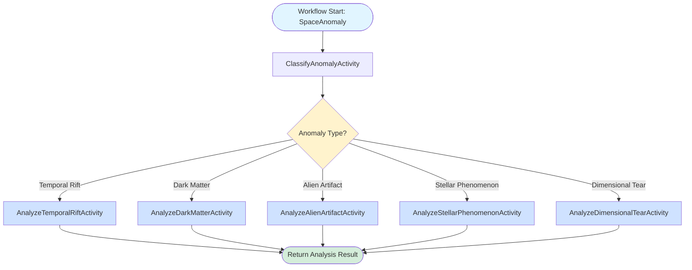

# Galactic Anomaly Classifier

This project demonstrates **Workflow Routing** using Dapr Workflow to classify and route different types of space anomalies to specialized analysis pipelines.

## Pattern Overview

The **workflow routing pattern** uses intelligent classification to route requests to specialized handlers. This demo implements a two-stage workflow:

1. **Classification Stage**: An LLM-powered classifier determines the anomaly type from sensor data
2. **Routing Stage**: Based on classification, routes to one of five specialized analysis activities:
   - **Temporal Rift** → Quantum Chronodynamics Analysis
   - **Dark Matter Cluster** → Gravitational Physics Analysis
   - **Alien Artifact** → Xenoarchaeology Analysis
   - **Stellar Phenomenon** → Astrophysics Analysis
   - **Dimensional Tear** → Multiverse Theory Analysis

### Key Features

- **Intelligent Routing**: LLM-powered classification routes to appropriate specialist
- **Specialized Analysis**: Each anomaly type gets domain-specific analysis
- **Durable Workflows**: Dapr Workflow ensures reliable execution
- **State Management**: Anomaly data and results persisted in state store
- **Observability**: Full workflow tracking and monitoring

### Benefits

- ✅ Specialized optimization - Different models and prompts per route
- ✅ Better accuracy - Domain-specific expertise for each category
- ✅ Cost efficiency - Use appropriate model size per complexity
- ✅ Easy extension - Add new anomaly types without affecting existing routes
- ✅ Clear metrics - Track performance per classification type

### Drawbacks

- ❌ Additional latency from classification step
- ❌ Misclassification can route to wrong specialist
- ❌ More complex to maintain multiple specialized handlers
- ❌ Requires training data or examples for accurate classification

### When to Use

Use this pattern when you have distinct categories requiring specialized handling, when different routes benefit from different models/prompts, or when you need to optimize cost/latency per category. Ideal for multi-domain systems, tiered support routing, and specialized expert consultation.

## Architecture



## Running the Demo

### Prerequisites

- [.NET 10 SDK](https://dotnet.microsoft.com/en-us/download)
- [Aspire CLI](https://aspire.dev/get-started/install-cli/) — install with `dotnet tool install -g Aspire.Cli`
- [Docker](https://www.docker.com/products/docker-desktop/) or [Podman](https://podman.io/docs/installation)
- [Dapr CLI](https://docs.dapr.io/getting-started/install-dapr-cli/) (version 1.18+)
- [Ollama](https://ollama.com/) with the `llama3.2:3b` model pulled

### Start Ollama

```bash
ollama serve
ollama pull llama3.2:3b
```

### Use OpenAI instead of Ollama

The `Resources` folder of the AppHost also contains `conversation-openai.yaml` (model `gpt-4.1-mini`) and `env-secret.yaml` (an environment variable secret store). Both Conversation components are named `conversation`, so keep only one of them in `Resources`. To use OpenAI, remove the Ollama component file and set the API key before starting the app:

```bash
export OPENAI_API_KEY=<your-key>
```

### Run the Application

From the `GalacticAnomalyClassifier/` folder:

```bash
aspire run
```

This launches the Aspire AppHost, which orchestrates:
- A Valkey container for workflow state persistence (port 16379, password-protected)
- The ApiService with a Dapr sidecar (app ID `anomaly-routing-app`)
- The `web` resource (LCARS web UI) on http://localhost:5503
- The Diagrid Dapr Dev Dashboard (`dapr-dev-dashboard` resource) on http://localhost:9090

The Aspire dashboard opens automatically in the browser at https://localhost:15000 (the same port for every demo), showing all resources and their status.

### Use the web UI

Open http://localhost:5503, pick a preset (Temporal rift, Dark matter, Alien artifact, Stellar phenomenon or Dimensional tear) or edit the sensor data and measurements (at least one measurement row is required), and choose **Classify anomaly**. The page polls the status endpoint every 2 seconds and shows a routing board: the classifier completes first, then the lane for the anomaly type the LLM chose lights up while the other lanes show as not routed. The findings view shows the anomaly type, classification, specialized analysis, metrics, recommendations and threat level. A critical or severe threat level switches the page to Red Alert.

The status endpoint (`GET /anomaly/status/{instanceId}`) returns `instanceId`, `status`, `result`, `progress` (the current stage and, once routed, the anomaly type and confidence, taken from the workflow custom status), `createdAt` and `lastUpdatedAt`.

**Durable timeline.** A strip of beads under the progress heading shows the saved steps of the run: one bead per saved checkpoint, with two beads in total (classification, specialist analysis). A bead flashes `saved` when it appears while you watch. The strip is driven by the status the workflow reports, not by a timer.

**Confidence arc and track switch.** Once the classifier has routed the anomaly, a semicircular arc fills to the classifier's confidence (the real value from the workflow status, shown as a percentage) and then a switch lever swings from the classifier to the lane of the chosen anomaly type. A finished run keeps the final arc and lever position.

**Show the crash.** Start a run, then stop only the ApiService resource `wf-app` while the run is going: use the Stop action for `wf-app` in the Aspire dashboard at https://localhost:15000, or run `aspire resource wf-app stop`. Within a few seconds (typically 5 to 7) the page shows `Subspace link lost: state is safe`, the current bead turns red, the beads freeze and a counter shows how long the link has been down. Start `wf-app` again (the dashboard, or `aspire resource wf-app start`). The page reports that the link is restored and how many checkpoints were saved, and the run continues with the saved steps kept. The step that was running at the moment of the crash is executed again. The animations respect the browser's reduced-motion setting and show the final state at once.

### Test with REST Client

Open `GalacticAnomalyClassifier.ApiService/GalacticAnomalyClassifier.ApiService.http` in VS Code and execute the requests to classify different anomalies. The ApiService HTTP port is shown in the Aspire dashboard.

### Inspect the Workflow runs

Open the Diagrid Dapr Dev Dashboard at `http://localhost:9090` and inspect the workflow executions.

## Inspect runs with the Diagrid Dapr Dev Dashboard

The [Diagrid Dapr Dev Dashboard](https://github.com/diagridio/dev-dashboard) is an optional local tool that finds the apps you start with `dapr run` or Aspire and shows their workflow instances (status and execution history), sidecars, components, subscriptions and logs.

Install it once:

- macOS / Linux:

  ```shell
  curl -sSL https://raw.githubusercontent.com/diagridio/dev-dashboard/main/scripts/install.sh | sh
  ```

- Windows (PowerShell):

  ```powershell
  iwr -useb https://raw.githubusercontent.com/diagridio/dev-dashboard/main/scripts/install.ps1 | iex
  ```

`aspire run` starts it as the `dapr-dev-dashboard` resource; open it from the Aspire dashboard or at http://localhost:9090. If it is not installed, only that resource fails to start; the app keeps running.
