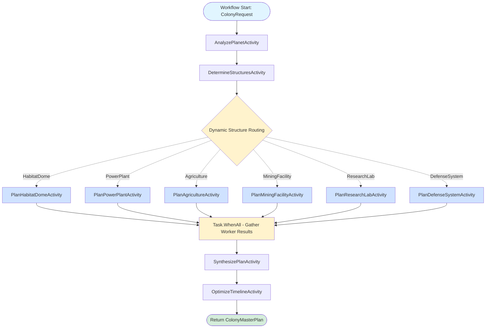

# Space Colony Planner

This demo implements an **orchestrator-worker workflow** using Dapr Workflow for dynamic colony construction planning. The orchestrator analyzes a planet's unique conditions and dynamically determines which specialist workers are needed to create a comprehensive colony construction plan. Different planets require different structures, making this an ideal use case for the orchestrator-worker pattern.

## Pattern Overview

The **orchestrator-worker pattern** dynamically decomposes complex tasks into specialized subtasks executed by parallel workers. This demo implements a dynamic colony planning workflow:

1. **Orchestrator** analyzes planet conditions and determines required structures
2. **Dynamic Task Decomposition** creates the appropriate set of worker tasks
3. **Parallel Workers** execute specialized planning for each structure type
4. **Synthesis** combines worker outputs into a coherent master plan

### Key Features

- **Dynamic task decomposition** - The orchestrator determines which structures are needed based on planet conditions
- **Specialist workers** - Each structure type has a dedicated expert planner
- **Parallel execution** - Worker tasks run concurrently using Task.WhenAll
- **Intelligent synthesis** - Results are combined into a coherent construction timeline
- **Scalable complexity** - Automatically adjusts to simple or complex colony requirements

### Benefits

- ✅ Parallel execution reduces overall latency
- ✅ Specialized workers optimized for specific domains
- ✅ Dynamic task decomposition adapts to varying requirements
- ✅ Easy to add new worker types without changing orchestrator logic
- ✅ Clear separation between coordination and execution

### Drawbacks

- ❌ More complex orchestration logic
- ❌ Overhead from coordination and synthesis steps
- ❌ Requires careful state management across parallel workers
- ❌ Potential resource contention with many parallel workers

### When to Use

Use this pattern when tasks can be decomposed into independent subtasks, when different subtasks require specialized expertise, or when parallelization provides significant performance benefits. Ideal for complex planning, distributed analysis, and modular system design.

## Architecture



- **ColonyOrchestratorWorkflow** - Main orchestrator that coordinates the planning process
- **Analysis Activities** - Analyze planet, determine structures, and synthesize the master plan
- **Worker Activities** - Specialized planners for different structure types (habitat domes, power plants, agriculture, etc.)

## Running the Demo

### Prerequisites

- [.NET 10 SDK](https://dotnet.microsoft.com/en-us/download)
- [Aspire CLI](https://aspire.dev/get-started/install-cli/) — install with `dotnet tool install -g Aspire.Cli`
- [Docker](https://www.docker.com/products/docker-desktop/) or [Podman](https://podman.io/docs/installation)
- [Dapr CLI](https://docs.dapr.io/getting-started/install-dapr-cli/) (version 1.18+)
- [Ollama](https://ollama.com/) with the `llama3.2:3b` model pulled

### Start Ollama

```bash
ollama serve
ollama pull llama3.2:3b
```

### Use OpenAI instead of Ollama

The `Resources` folder of the AppHost also contains `conversation-openai.yaml` (model `gpt-4.1-mini`) and `env-secret.yaml` (an environment variable secret store). Both Conversation components are named `conversation`, so keep only one of them in `Resources`. To use OpenAI, remove the Ollama component file and set the API key before starting the app:

```bash
export OPENAI_API_KEY=<your-key>
```

### Run the Application

From the `SpaceColonyPlanner/` folder:

```bash
aspire run
```

This launches the Aspire AppHost, which orchestrates:
- A Valkey container for workflow state persistence (port 16379, password-protected)
- The ApiService with a Dapr sidecar (app ID `space-colony-planner-app`)
- The `web` resource (LCARS web UI) on http://localhost:5504
- The Diagrid Dapr Dev Dashboard (`dapr-dev-dashboard` resource) on http://localhost:9090

The Aspire dashboard opens automatically in the browser at https://localhost:15000 (the same port for every demo), showing all resources and their status.

### Use the web UI

Open http://localhost:5504, pick a preset (Arrakis Minor, Glacius Prime or Eden Prime) or edit the survey, and choose **Plan colony**. The form is grouped as planet, conditions, resources (checkboxes plus the soil quality) and requirements. The page polls the plan endpoint every 2 seconds. The running view shows the planet analysis and structure selection as bars, then one lane per structure the orchestrator selected (type, priority and quantity), so the number of lanes differs per planet. Each lane sweeps as `PLANNING` until its specialist worker finishes and then shows `COMPLETE`, in whatever order the workers finish. Synthesis and timeline optimisation follow as two more bars. The result view shows the total construction days and the number of structures, a bar per construction phase scaled to the longest phase, expandable structure rows (materials, days, worker hours, prerequisites and specification), the materials table, and the success factors and risk assessment text.

### Test with REST Client

Open `SpaceColonyPlanner.ApiService/SpaceColonyPlanner.ApiService.http` in VS Code and execute the requests to plan different colonies. The ApiService HTTP port is shown in the Aspire dashboard.

The status endpoint `GET /colony/plan/{instanceId}` returns `result` (the master plan, only when the workflow is `Completed`; this field was called `plan` before) and `progress` (the current stage and the list of structures with a `done` flag). An unknown instance ID returns 404.

### Inspect the Workflow runs

Open the Diagrid Dapr Dev Dashboard at `http://localhost:9090` and inspect the workflow executions.

## Inspect runs with the Diagrid Dapr Dev Dashboard

The [Diagrid Dapr Dev Dashboard](https://github.com/diagridio/dev-dashboard) is an optional local tool that finds the apps you start with `dapr run` or Aspire and shows their workflow instances (status and execution history), sidecars, components, subscriptions and logs.

Install it once:

- macOS / Linux:

  ```shell
  curl -sSL https://raw.githubusercontent.com/diagridio/dev-dashboard/main/scripts/install.sh | sh
  ```

- Windows (PowerShell):

  ```powershell
  iwr -useb https://raw.githubusercontent.com/diagridio/dev-dashboard/main/scripts/install.ps1 | iex
  ```

`aspire run` starts it as the `dapr-dev-dashboard` resource; open it from the Aspire dashboard or at http://localhost:9090. If it is not installed, only that resource fails to start; the app keeps running.
