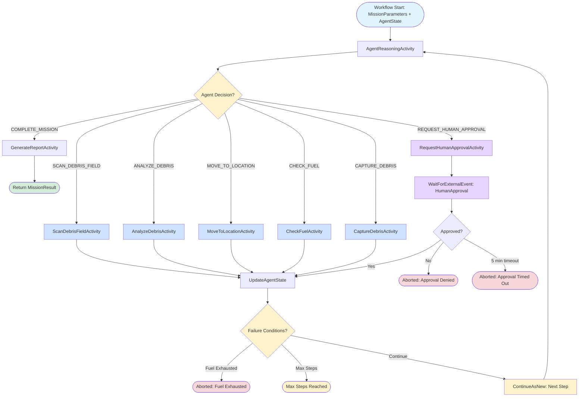

# Space Debris Cleanup - Autonomous Agent Pattern

This demo implements a fully autonomous agent using Dapr Workflow that controls a space debris cleanup mission. The agent makes its own decisions about scanning, analyzing, capturing debris, and requesting human approval for high-risk maneuvers.

## Pattern Overview

The **autonomous agent pattern** implements a self-directed reasoning loop where an LLM decides which actions to take based on current state and observations. This demo features:

1. **Agent Reasoning Loop** - LLM evaluates state and selects next action
2. **Tool Execution** - Agent can invoke tools (scan, move, capture, analyze)
3. **Human-in-the-Loop** - Requests approval for high-risk maneuvers
4. **State Persistence** - ContinueAsNew pattern maintains mission state
5. **Error Recovery** - Adapts to tool failures and unexpected situations

### Key Features

- **Autonomous Decision-Making**: Agent uses LLM to reason and choose actions
- **Tool Usage**: Scan, analyze, navigate, capture debris, check fuel
- **Human-in-the-Loop**: Requests approval for risky maneuvers with timeout
- **Error Recovery**: Adapts to tool failures and unexpected situations
- **State Persistence**: Continues mission across failures using ContinueAsNew
- **External Events**: Workflow waits for human approval via RaiseEventAsync

### Benefits

- ✅ Fully autonomous operation reduces manual intervention
- ✅ Adapts to dynamic environments and unexpected situations
- ✅ Human oversight for critical decisions
- ✅ Resilient to failures with state persistence
- ✅ Extensible tool library for new capabilities

### Drawbacks

- ❌ Unpredictable behavior - agent makes its own choices
- ❌ Higher latency from reasoning loop overhead
- ❌ More expensive due to multiple LLM calls per decision
- ❌ Requires careful prompt engineering for reliable behavior
- ❌ Difficult to debug when agent makes unexpected choices

### When to Use

Use this pattern when tasks require autonomous decision-making in dynamic environments, when the sequence of actions cannot be predetermined, or when you need adaptive behavior based on observations. Ideal for robotic control, dynamic task planning, and interactive systems requiring judgment calls.

## Architecture



- **SpaceDebrisCleanupWorkflow**: Main agent loop with ContinueAsNew pattern
- **AgentReasoningActivity**: LLM-based decision making
- **Tool Activities**: Scan, Capture, Move, Analyze, CheckFuel, RequestApproval
- **External Events**: Human approval with 5-minute timeout

## Running the Demo

### Prerequisites

- [.NET 10 SDK](https://dotnet.microsoft.com/en-us/download)
- [Aspire CLI](https://aspire.dev/get-started/install-cli/) — install with `dotnet tool install -g Aspire.Cli`
- [Docker](https://www.docker.com/products/docker-desktop/) or [Podman](https://podman.io/docs/installation)
- [Dapr CLI](https://docs.dapr.io/getting-started/install-dapr-cli/) (version 1.19+)
- [Ollama](https://ollama.com/) with the `llama3.2:3b` model pulled

### Start Ollama

```bash
ollama serve
ollama pull llama3.2:3b
```

### Use OpenAI instead of Ollama

The `Resources` folder of the AppHost also contains `conversation-openai.yaml` (model `gpt-4.1-mini`) and `env-secret.yaml` (an environment variable secret store). Both Conversation components are named `conversation`, so keep only one of them in `Resources`. To use OpenAI, remove the Ollama component file and set the API key before starting the app:

```bash
export OPENAI_API_KEY=<your-key>
```

### Run the Application

From the `SpaceDebrisAgent/` folder:

```bash
aspire run
```

This launches the Aspire AppHost, which orchestrates:
- A Valkey container for workflow state persistence (port 16379, password-protected)
- The ApiService with a Dapr sidecar (app ID `space-debris-agent`)
- The `web` resource (LCARS web UI) on http://localhost:5505
- The Diagrid Dapr Dev Dashboard (`dapr-dev-dashboard` resource) on http://localhost:9090/workflows

The Aspire dashboard opens automatically in the browser at https://localhost:15000 (the same port for every demo), showing all resources and their status.

### Use the web UI

Open http://localhost:5505, pick a preset (LEO cleanup, MEO aggressive or GEO conservative) or edit the form, and choose **Launch mission**. The form takes a mission id, the orbital zone, the maximum number of debris pieces, the fuel budget (kg), the maximum mission hours and a switch that lets the agent ask for human approval. The mission id is generated for every run (`<ZONE>-<uuid>`, because the instance id is `CLEAN-<missionId>`); you can edit it, but it may only contain letters, digits, `-` and `_`. The page polls the status endpoint every 2 seconds. The running view shows a step meter (`STEP n / 15`) and a decision log that grows while the agent works: one row per step with the chosen action as a pill and the agent's reasoning in an expandable, plus a sweeping `THINKING…` row for the step that is in progress. The log keeps its rows across the `ContinueAsNew` restarts of the loop.

The `requireHumanApproval` switch only makes the agent *able* to ask; the agent decides whether it does. When it asks, an approval panel appears above the log (keyboard focus moves to its heading once and screen readers announce it once) with the request as key/value rows, a countdown to the 5-minute timeout, a reason field and **Approve** / **Deny** buttons that call `POST /mission/{instanceId}/approval`. Both buttons are disabled after one click (a failed request shows the error and enables them again), and the panel closes as soon as the workflow stops waiting, which includes the timeout, where the workflow defaults to denied. The result view shows `MISSION COMPLETE` or `MISSION ABORTED` (aborted missions, for example after a denial, turn the page into Red Alert), counters for debris captured, fuel used and total steps, the summary, the lessons learned, and the agent decisions and tool calls as expandable rows.

**Durable timeline.** A strip of beads under the progress heading shows the saved steps of the run: one bead per recorded decision, with ghost beads up to the step limit (15 unless the status reports another). A bead flashes `saved` when it appears while you watch. The strip is driven by the status the workflow reports, not by a timer.

**Typed reasoning preview and action pill pulse.** When a new decision appears while you watch, a short preview of the agent's reasoning types out under its row (the newest batch only; the full text is still in the expandable) and the action pill pulses once after the typing. Decisions that were there when the page first rendered appear instantly.

**Show the crash.** Start a run, then stop only the ApiService resource `wf-app` while the run is going: use the Stop action for `wf-app` in the Aspire dashboard at https://localhost:15000, or run `aspire resource wf-app stop`. Within a few seconds (typically 5 to 7) the page shows `Subspace link lost: state is safe`, the current bead turns red, the beads freeze and a counter shows how long the link has been down. Start `wf-app` again (the dashboard, or `aspire resource wf-app start`). The page reports that the link is restored and how many checkpoints were saved, and the run continues with the saved steps kept. The step that was running at the moment of the crash is executed again. If the approval panel is open during the outage it stays open and the Approve and Deny buttons stay enabled; a click while the link is down fails with the usual error. The animations respect the browser's reduced-motion setting and show the final state at once.

**Token usage.** Each activity that calls the LLM returns its result wrapped in `Metered<T>` together with the prompt and completion tokens the provider reported. The workflow adds these up and publishes the running total as `usage` (`promptTokens`, `completionTokens`, `totalTokens`) in its custom status, so the status endpoint returns it as `progress.usage`. The progress panel shows a running **Tokens** readout that counts up as polls arrive, and the findings panel shows the final total with the prompt/completion split. If the provider reports no usage (null or zero), the page shows `--`. Tokens of failed or retried attempts are not counted. Only `AgentReasoning` and `ScanDebrisField` call the LLM and are metered. The running total is carried across `ContinueAsNew` in an optional trailing `Usage` on the workflow input. Runs that were in flight before upgrading to this version fail on replay (the activity outputs changed to `Metered<T>`), so let them finish or reset the state store (stop the app and clear Valkey) first.

### Test with REST Client

Open `SpaceDebrisAgent.ApiService/SpaceDebrisAgent.ApiService.http` in VS Code and execute the requests to start a cleanup mission. The ApiService HTTP port is shown in the Aspire dashboard.

### Inspect the Workflow runs

Open the Diagrid Dapr Dev Dashboard at `http://localhost:9090/workflows` and inspect the workflow executions.

## Inspect runs with the Diagrid Dapr Dev Dashboard

The [Diagrid Dapr Dev Dashboard](https://github.com/diagridio/dev-dashboard) is an optional local tool that finds the apps you start with `dapr run` or Aspire and shows their workflow instances (status and execution history), sidecars, components, subscriptions and logs.

Install it once:

- macOS / Linux:

  ```shell
  curl -sSL https://raw.githubusercontent.com/diagridio/dev-dashboard/main/scripts/install.sh | sh
  ```

- Windows (PowerShell):

  ```powershell
  iwr -useb https://raw.githubusercontent.com/diagridio/dev-dashboard/main/scripts/install.ps1 | iex
  ```

`aspire run` starts it as the `dapr-dev-dashboard` resource; open it from the Aspire dashboard or at http://localhost:9090/workflows. If it is not installed, only that resource fails to start; the app keeps running.
