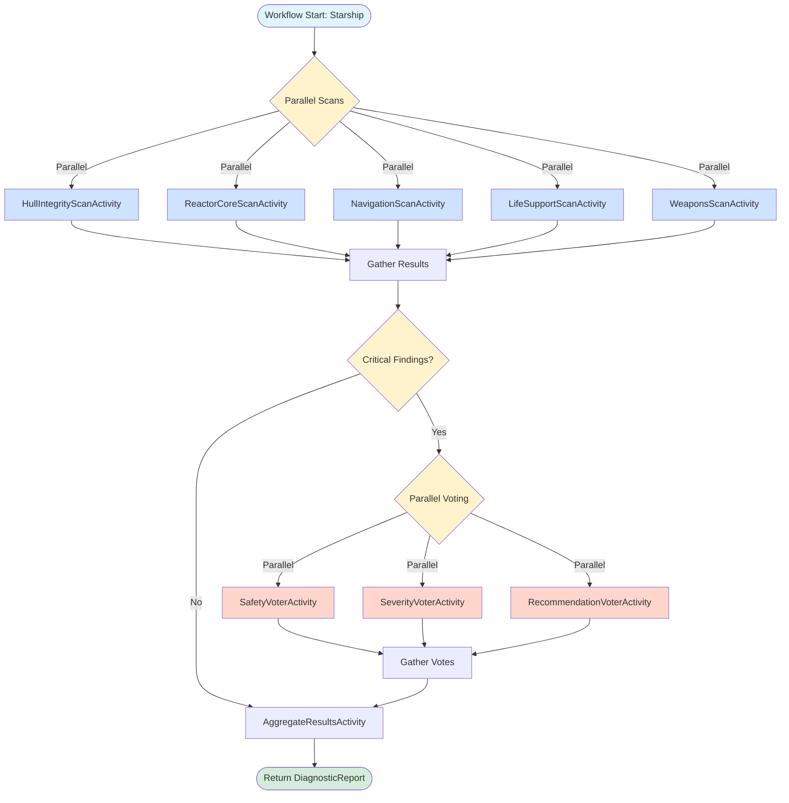

# StarshipDiagnostics - Parallel Workflow Pattern Demo

This demo implements the **parallelization workflow pattern** using Dapr Workflow to perform comprehensive diagnostics on starships like the USS Enterprise-D. The system runs multiple independent scans simultaneously (sectioning) across all major ship systems and uses voting mechanisms to assess critical findings.

## Pattern Overview

The **parallelization pattern** breaks work into independent parallel tasks for faster execution and uses voting mechanisms for consensus on critical decisions. This demo showcases:

1. **Sectioning** - Breaking work into independent parallel tasks
2. **Voting** - Using multiple AI models for consensus on critical decisions
3. **Aggregation** - Combining parallel results into a unified output

### Key Features

- **Parallel Scanner Activities**: Five independent diagnostic scans run simultaneously
  - Hull Integrity Scanner
  - Reactor Core Scanner
  - Navigation Systems Scanner
  - Life Support Scanner
  - Tactical Systems Scanner
- **Voting Pattern**: Critical findings trigger parallel evaluation by three AI voters
  - Safety Voter (crew safety perspective)
  - Severity Voter (technical severity assessment)
  - Recommendation Voter (cost-benefit analysis)
- **Result Aggregation**: Combines all scan results and votes into a comprehensive diagnostic report

### Benefits

- ✅ Parallel execution dramatically reduces total scan time
- ✅ Independent scans prevent cross-contamination of results
- ✅ Voting ensures robust decisions on critical findings
- ✅ Easy to add new scan types or voters
- ✅ Workflow orchestration provides reliability and observability

### Drawbacks

- ❌ Resource intensive - multiple LLM calls running concurrently
- ❌ More expensive than sequential processing
- ❌ Requires orchestration overhead
- ❌ Voting can increase latency for critical findings

### When to Use

Use this pattern when tasks are independent and can run in parallel, when you need consensus on critical decisions, or when reducing total execution time is more important than cost. Ideal for comprehensive diagnostics, multi-perspective analysis, and distributed validation.

## Architecture



### Implementation Details

- **Dapr Workflow**: Orchestrates parallel execution and voting
- **Dapr State Management**: Stores scan results and maintenance history
- **Dapr Conversation API**: Powers each diagnostic scan and vote using LLMs

## Running the Demo

### Prerequisites

- [.NET 10 SDK](https://dotnet.microsoft.com/en-us/download)
- [Aspire CLI](https://aspire.dev/get-started/install-cli/) — install with `dotnet tool install -g Aspire.Cli`
- [Docker](https://www.docker.com/products/docker-desktop/) or [Podman](https://podman.io/docs/installation)
- [Dapr CLI](https://docs.dapr.io/getting-started/install-dapr-cli/) (version 1.18+)
- [Ollama](https://ollama.com/) with the `llama3.2:3b` model pulled

### Start Ollama

```bash
ollama serve
ollama pull llama3.2:3b
```

### Use OpenAI instead of Ollama

The `Resources` folder of the AppHost also contains `conversation-openai.yaml` (model `gpt-4.1-mini`) and `env-secret.yaml` (an environment variable secret store). Both Conversation components are named `conversation`, so keep only one of them in `Resources`. To use OpenAI, remove the Ollama component file and set the API key before starting the app:

```bash
export OPENAI_API_KEY=<your-key>
```

### Run the Application

From the `StarshipDiagnostics/` folder:

```bash
aspire run
```

This launches the Aspire AppHost, which orchestrates:
- A Valkey container for workflow state persistence (port 16379, password-protected)
- The ApiService with a Dapr sidecar (app ID `starship-diagnostics-app`)
- The `web` resource (LCARS web UI) on http://localhost:5501
- The Diagrid Dapr Dev Dashboard (`dapr-dev-dashboard` resource) on http://localhost:9090

The Aspire dashboard opens automatically in the browser, showing all resources and their status.

### Use the web UI

Open http://localhost:5501, pick a preset (Enterprise-D, Enterprise (original) or Enterprise-E) or edit the ship data and telemetry, and choose **Run diagnostics**. The page polls the report endpoint every 2 seconds and shows five subsystem tiles (hull integrity, reactor core, navigation, life support and weapons). Each tile shows a sweeping bar and the label `Scanning` until its scan finishes, in whatever order the scans complete, and then shows the health percentage and a status colour. When a scan comes back critical, a vote panel shows one row per critical finding, pending until the three voters (Safety, Severity and Recommendation) reach a consensus. The report view shows `CLEAR FOR DEPARTURE` or `DEPARTURE HELD`, the overall status, expandable subsystem rows with issues, recommendations and the detailed analysis, the vote results, the required repairs and the estimated repair hours. A ship that is not cleared for departure switches the page to Red Alert.

The report endpoint (`GET /ship/report/{instanceId}`) returns `instanceId`, `status`, `result`, `progress` (the stage plus the finished scans and votes, taken from the workflow custom status), `createdAt` and `lastUpdatedAt`.

### Test with REST Client

Open `StarshipDiagnostics.ApiService/StarshipDiagnostics.ApiService.http` in VS Code and execute the requests to start a diagnostic scan. The ApiService HTTP port is shown in the Aspire dashboard.

### Inspect the Workflow runs

Open the Diagrid Dapr Dev Dashboard at `http://localhost:9090` and inspect the workflow executions.

## Inspect runs with the Diagrid Dapr Dev Dashboard

The [Diagrid Dapr Dev Dashboard](https://github.com/diagridio/dev-dashboard) is an optional local tool that finds the apps you start with `dapr run` or Aspire and shows their workflow instances (status and execution history), sidecars, components, subscriptions and logs.

Install it once:

- macOS / Linux:

  ```shell
  curl -sSL https://raw.githubusercontent.com/diagridio/dev-dashboard/main/scripts/install.sh | sh
  ```

- Windows (PowerShell):

  ```powershell
  iwr -useb https://raw.githubusercontent.com/diagridio/dev-dashboard/main/scripts/install.ps1 | iex
  ```

`aspire run` starts it as the `dapr-dev-dashboard` resource; open it from the Aspire dashboard or at http://localhost:9090. If it is not installed, only that resource fails to start; the app keeps running.
